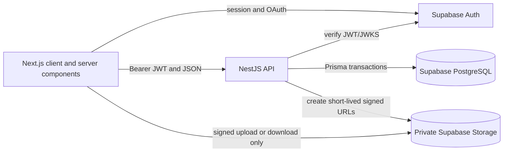
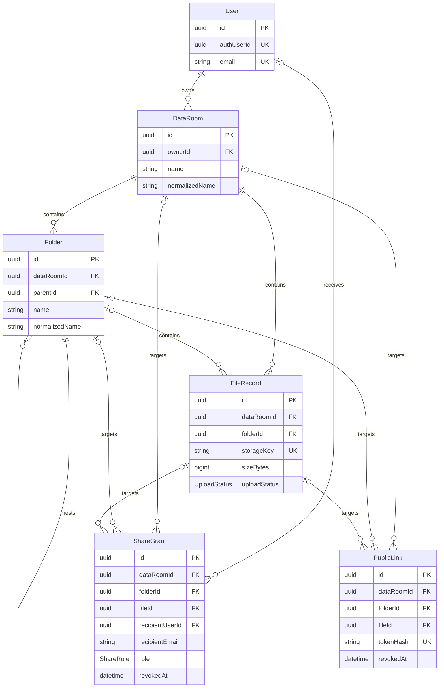

# Secure Data Room MVP

A full-stack virtual Data Room for organizing and securely sharing due-diligence PDFs. Owners can create multiple Data Rooms, build nested folder hierarchies, upload and manage files, and grant read-only access through public links or registered-user shares.

## Live application

- Web: https://secure-data-room-mvp-web.vercel.app
- API health: https://api-production-cbcb.up.railway.app/api/v1/health
- Source: https://github.com/Azmodan13/secure-data-room-mvp

## Highlights

- Email/password and Google authentication through Supabase Auth
- Owner-isolated Data Rooms with nested folders and breadcrumb navigation
- Multi-file PDF upload with drag-and-drop and per-file progress
- Direct browser-to-Supabase Storage uploads using short-lived signed URLs
- PDF preview and download through authorization-checked signed URLs
- Rename, move, bulk move, delete, and bulk delete workflows
- Explicit conflict handling for duplicate names
- Public links for a Data Room, folder, or file, with revocation
- Permissioned read-only sharing with registered users
- Inherited access for nested folder content without duplicated grants
- List and grid views, sorting, cursor pagination, and configurable page size
- Responsive light, dark, and system themes

## Tech stack

| Layer          | Technology                                            |
| -------------- | ----------------------------------------------------- |
| Monorepo       | npm workspaces                                        |
| Frontend       | Next.js 16, React 19, TypeScript, Tailwind CSS        |
| UI and forms   | Radix UI, Lucide, React Hook Form, Zod                |
| Server state   | TanStack Query                                        |
| Backend        | NestJS 11, TypeScript                                 |
| Database       | PostgreSQL on Supabase, Prisma 6                      |
| Authentication | Supabase Auth, Google OAuth, JWT validation with JOSE |
| File storage   | Private Supabase Storage bucket                       |
| Hosting        | Vercel (web), Railway/Docker (API)                    |

## Local setup

### Prerequisites

- Node.js 22
- npm 10 or newer
- A Supabase project
- A Google OAuth client if Google sign-in is required locally

### 1. Install dependencies

```bash
nvm use
npm install
```

### 2. Configure Supabase

Create a private Storage bucket named `data-room-files`. Keep storage secret keys exclusively in the API environment.

Configure Supabase Auth with email/password and, optionally, Google. Add these redirect URLs:

```text
http://localhost:3000/**
https://your-production-web-origin/**
```

### 3. Configure environment variables

```bash
cp apps/api/.env.example apps/api/.env
cp apps/web/.env.local.example apps/web/.env.local
```

API variables:

| Variable                   | Purpose                                                  |
| -------------------------- | -------------------------------------------------------- |
| `PORT`                     | API port; defaults to `3001` locally                     |
| `WEB_ORIGIN`               | Allowed browser origin for CORS                          |
| `DATABASE_URL`             | PostgreSQL transaction-pooler connection used at runtime |
| `DIRECT_URL`               | Session/direct connection used by Prisma migrations      |
| `SUPABASE_URL`             | Supabase project URL                                     |
| `SUPABASE_PUBLISHABLE_KEY` | Supabase publishable key                                 |
| `SUPABASE_SECRET_KEY`      | Server-only key for Storage operations                   |
| `SUPABASE_STORAGE_BUCKET`  | Private file bucket name                                 |
| `SUPABASE_JWT_ISSUER`      | Expected access-token issuer                             |
| `SUPABASE_JWT_AUDIENCE`    | Expected JWT audience, normally `authenticated`          |

Web variables:

| Variable                               | Purpose                          |
| -------------------------------------- | -------------------------------- |
| `NEXT_PUBLIC_API_URL`                  | API base URL including `/api/v1` |
| `NEXT_PUBLIC_SUPABASE_URL`             | Supabase project URL             |
| `NEXT_PUBLIC_SUPABASE_PUBLISHABLE_KEY` | Browser-safe Supabase key        |

Never expose `SUPABASE_SECRET_KEY`, database credentials, access tokens, or signed Storage URLs through `NEXT_PUBLIC_*` variables or Git.

### 4. Apply the database migrations

```bash
npm run prisma:generate
npm run prisma:migrate:deploy
```

For a new local development migration, use `npm run prisma:migrate:dev` instead.

### 5. Start both applications

```bash
npm run dev
```

- Web: http://localhost:3000
- API: http://localhost:3001/api/v1
- Health check: http://localhost:3001/api/v1/health

## Validation commands

```bash
npm run lint
npm run test
npm run test:e2e --workspace=apps/api -- --runInBand
npm run build
```

Security-critical manual scenarios are documented in [docs/acceptance-matrix.md](docs/acceptance-matrix.md).

## Architecture



The NestJS API is the authorization boundary. The frontend never reads or mutates domain tables directly. Every metadata operation passes through the API and the centralized access policy. The browser contacts Storage only after the API has authorized the request and issued a short-lived signed URL.

Uploads use a three-step protocol:

1. The client requests an upload intent from the API.
2. The API validates ownership, reserves a database record, and returns a signed upload URL.
3. The browser uploads directly to Storage and asks the API to confirm the file.

This keeps large file bytes away from the API process while preserving server-side authorization and metadata consistency. Deletion is coordinated by the API across PostgreSQL and Storage; failed cleanup is represented by an explicit upload status instead of silently reporting success.

## Data model



`ShareGrant` and `PublicLink` each use three nullable target foreign keys. Database check constraints created by migrations ensure that exactly one target is set. The raw public token is returned once; only its hash is stored. Partial unique indexes prevent duplicate active grants and more than one active public link for the same target.

Normalized names and database uniqueness constraints make conflict behavior deterministic and race-safe. Foreign-key cascades remove nested metadata, while the service layer handles associated Storage objects and destructive warnings.

## How it scales

### How is total folder size and item count computed for the whole subtree?

The MVP uses a recursive PostgreSQL CTE over the adjacency-list `Folder.parentId` hierarchy, then aggregates descendant folders and files. This is simple and correct for the expected take-home dataset, and it keeps the write path inexpensive.

At higher read volume, I would add a materialized aggregate per folder (`descendantItemCount`, `descendantSizeBytes`) and update ancestor aggregates transactionally or through an outbox-backed worker. A closure table or materialized path can make ancestor traversal predictable for very deep hierarchies. Periodic reconciliation would detect and repair aggregate drift.

### What changes when one Data Room holds 100,000 files?

- Keep cursor/keyset pagination; never load or count the entire room on every request.
- Query only the current folder and request the next page using stable sort columns plus `id` as a tie-breaker.
- Retain composite indexes matching listing paths, such as `(folder_id, created_at, id)` and `(data_room_id, folder_id)`.
- Add matching indexes for each supported sort, for example normalized name or size plus `id`.
- Avoid synchronous recursive counts during ordinary listing; serve cached aggregates.
- Move expensive deletion, ZIP generation, checksum calculation, and reconciliation to background jobs.
- Stream exports and use bounded-concurrency Storage operations.
- Add rate limits, observability, query-duration alerts, and load tests using realistic folder distributions.

The current UI requests bounded pages and supports 10, 25, and 50 items per page rather than rendering an unbounded list.

### How does sharing extend to viewer/editor roles without remodeling?

`ShareGrant` already has a `role` column and resource target fields, so the schema does not need to be remodeled. Add `EDITOR` to `ShareRole`, map actions to required capabilities, and let the access-policy service calculate the strongest applicable role from ownership, room grants, ancestor-folder grants, and direct file grants. Public links remain viewer-only unless a separate product decision explicitly permits mutations.

For a larger role system, the enum can evolve into `Role`, `Permission`, and `RolePermission` tables while keeping `ShareGrant` as the assignment record.

## Security decisions

- The API validates Supabase JWT signature, issuer, audience, and expiry against remote JWKS.
- Cross-tenant resources return a neutral `404` to avoid revealing their existence.
- Private Storage objects are accessed only through short-lived signed URLs.
- Public-link tokens are high-entropy values stored only as hashes.
- Share and public-link revocation is enforced on the next API request.
- Owners alone can mutate resources or administer access.
- Name uniqueness and target invariants are enforced in PostgreSQL, not only in UI validation.
- CORS is restricted to the configured web origin.

## Deployment

The web workspace is deployed to Vercel with `apps/web` as its root. The API is built from [Dockerfile.api](Dockerfile.api) and deployed to Railway. Railway runs Prisma migrations during deployment before starting NestJS. PostgreSQL, Auth, and private blob storage are hosted by Supabase.

Required production configuration:

- Set the web origin in `WEB_ORIGIN`.
- Set the Railway API URL in `NEXT_PUBLIC_API_URL`, including `/api/v1`.
- Add the production callback pattern to Supabase Auth redirect URLs.
- Add the Supabase callback URL to the Google OAuth client.
- Keep all database and server-side Supabase secrets in Railway only.

## Design decisions and trade-offs

- **Separate frontend and API:** reflects the requested production stack and makes the authorization boundary explicit.
- **Direct signed uploads:** reduce API memory and bandwidth while retaining authorization control.
- **Adjacency-list folders:** straightforward CRUD and recursive querying for an MVP; documented upgrade paths cover aggregate-heavy scale.
- **Soft revocation for shares:** preserves an audit-friendly history while active partial indexes prevent duplicates.
- **Read-only sharing:** intentionally keeps the MVP permission model small, while the schema already has a role extension point.
- **No email delivery:** access is visible after a registered recipient signs in; outbound invitations are outside the core MVP.
- **No ZIP bulk download:** selected files can be managed individually; server-side archive generation is a stretch improvement.

## AI usage

AI tools, primarily OpenAI Codex, were used as a pair-programming assistant for planning, architecture discussions, implementation drafts, debugging, test generation, documentation, and review checklists. I reviewed the proposed decisions and code, ran the validation commands, manually tested the user flows, and made the final product and architecture choices. No credentials or tokens were committed to the repository or documentation, and generated output was not accepted without local verification.
